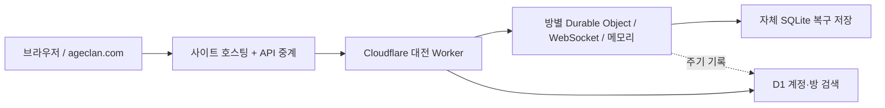

# 2D 네트워크 수정·핑 조사·Cloudflare 사용 현황

기준일: 2026-10-26 (한국 시간). 3D 코드는 변경하지 않았습니다.

## 적용 내용

1. 배속을 변경하면 **실제 시간 5초** 동안 방 전체에서 재변경할 수 없습니다. 전원이 같은 제한을 적용받습니다. 같은 속도를 다시 요청해도 대기시간을 연장하지 않습니다. 2배속에서도 5초이며 재접속 후에도 남은 제한을 유지합니다. 혼자하기에도 동일한 제한을 적용했습니다.
2. WebSocket 요청 제한(429)을 명령 ID가 포함된 ACK로 반환합니다. 클라이언트는 같은 명령 ID·순번으로 지연 재시도하여 중복 비용을 방지합니다. 기존 서버의 일반 error 형태도 호환 처리합니다. 재시도 횟수는 제한하며 연결을 끊는 3.5초 감시 타이머를 기다리지 않습니다.
3. 새 클릭도 공통 전송 간격을 지켜 ACK 직후 연타가 전송 간격을 우회하지 않게 했습니다.
4. 마지막 패킷 이후의 예측 시간을 매 프레임 당시 배속으로 누적합니다. 배속 변경이 이미 흐른 시간을 재계산하지 않으며 정상적으로 진군하는 적이 화면상 뒤로 걷지 않도록 보정합니다. 새 게임·큰 서버 위치 차이에 대한 기준 재설정은 유지합니다.
5. 숫자 ID인 적·포탑·투사체 배열에도 ID 기준 델타를 적용했습니다. 전체 배열을 반복 전송하는 양을 줄이고 상태 JSON 중복 직렬화도 줄였습니다.
6. 명령 순번·멱등성·권한·요청 제한·서버 권위 계산을 유지합니다. 저장 완료 전 먼저 응답하고 약 2초마다 복구 상태를 저장하는 기존 반응속도 우선 정책도 유지합니다. 따라서 **강제 서버 종료 직전의 약 2초 복구 한계까지 없어진 것은 아닙니다.**

## 검사 결과

- 실제 사이트를 경유한 비공개 방, 독립 게스트 세션 4개, 약 59초, 핑 256회.
- 입장·동시 건설·포탑 및 성채 강화·중복 명령 멱등성·전원 배속 권한·공통 잠금·실제 2배 시간 진행·재접속·관전 검사 통과. 4명 모두 퇴장 완료. 계정 업적·랭킹은 사용하지 않았습니다.
- 공통 배속 5초 잠금은 서로 다른 참가자가 변경해도 유지됩니다.
- 격리 재현에서 429 후 두 설치가 연결 재시작 없이 약 **295~326ms** 내에 완료됐습니다. ID·순번 재사용, 자원 중복 차감 없음, 후속 명령 전송도 확인했습니다.
- 이전 2배속→1배속 위치 역보정 재현, 늦은 서버 패킷, 3초 패킷 공백, 명령 미리보기/거절 시 복구, 게임 엔진 회귀 검사 통과.
- 실제 물리 기기 4대의 FPS·서로 다른 통신망·장시간 후반 웨이브는 이번 검사 범위가 아닙니다.

| 핑 왕복 | 수정 전 표본 | 수정 후 표본 |
| --- | ---: | ---: |
| 중앙값 | 30.4ms | 28.5ms |
| P95 | 72.8ms | 91.1ms |
| 최대 | 546.1ms | 328.9ms |
| 예기치 않은 소켓 종료 | 0회 | 0회 |

두 실행은 시간·웨이브 위치·배속 대기 구간이 다릅니다. 최대값이 줄었다고 전체 네트워크가 개선됐다고 단정하지 않습니다. P95는 오히려 증가했고, **300ms대 핑 튐과 최대 약 647ms 상태 전달 공백은 남았습니다.** 수정 후 명령 ACK는 중앙값 35.5ms / 최대 130.8ms입니다. 일반적인 상태 전달은 약 200ms 간격이며 화면은 그 사이를 예측합니다.

## 핑 튐 조사에서 확인한 것

### 확정한 코드 원인

- 429 일반 오류가 명령 대기 상태를 풀지 않는 문제: 설치 지연·조작 대기의 원인이 될 수 있어 수정했습니다.
- 배속 변경 시 과거 예측 시간을 다시 곱하는 문제: 적의 짧은 화면상 역이동을 재현했고 수정했습니다.

이 두 문제는 핑 숫자 그 자체와 구분합니다. 네트워크 RTT가 낮아도 명령 대기·위치 역보정이 발생할 수 있습니다.

### 아직 단정할 수 없는 부분

- 실제 접속의 Cloudflare 입구는 이번 PC에서 `ICN`, TLS 1.3이었습니다. 이것만으로 Durable Object의 실행 장소가 서울임을 뜻하지 않습니다.
- 가장 느린 표본의 클라이언트 이벤트 루프 지연 상한은 약 22.1ms였습니다. 시험 클라이언트 자체의 긴 실행 정지만으로 329ms RTT 전부를 설명하지 못합니다. 그러나 네트워크·Sites 게이트웨이·Worker 전달·플랫폼 스케줄링 중 어느 구간인지 확정할 수 없습니다.
- 높은 핑 표본에서 저장 중 표시가 false였으나 저장소가 원인이 아니라고 단정할 충분한 증거는 아닙니다. D1을 매 핑마다 조회하는 구조는 아닙니다.
- 서버 타이밍 계측을 추가했지만, Cloudflare Workers의 `performance.now()`와 `Date.now()`는 I/O 사이에서 멈춥니다. 순수 계산의 0ms는 CPU 비용이 없다는 뜻이 아닙니다. 배포된 진단에는 `clockMode: io-only`, `cpuTimingAvailable: false`를 명시하고 이 구간 값은 null로 반환합니다. 정밀 CPU 시간은 네이티브 분석·로컬 프로파일링과 함께 봐야 합니다. [공식 타이머 설명](https://developers.cloudflare.com/workers/runtime-apis/performance/)
- 조사 당시 지난 2시간의 외부 대전 Worker 분석에 호출 75건·보고 오류 0건이 보였습니다. 이 수치를 방 내부의 모든 WebSocket 메시지나 전체 서비스 안정성으로 확대 해석하지 않습니다.

## 현재 사용 중인 Cloudflare 서비스

| 서비스 | 확인 상태·용도 |
| --- | --- |
| Registrar | 공개 RDAP에 `Cloudflare, Inc.`가 등록기관으로 확인됨. ageclan.com 도메인 등록 |
| DNS·HTTPS·Cloudflare 엣지 | Cloudflare 네임서버 2개와 실제 ICN/TLS 연결 확인 |
| Workers | `age-clan-pvp` 실시간 API·계정 API. 배포된 버전의 리소스 바인딩 확인 |
| Durable Objects | 방마다 `ClanRoom` 하나. 진행 중 상태는 메모리에서 계산하고 자체 SQLite 저장소로 복구 |
| WebSocket | 브라우저↔사이트↔대전 Worker↔방 서버 연결. 연결 장애 시 같은 방의 HTTP 경로 사용 |
| D1 | `age-clan-pvp-db`: 방 디렉터리, 계정·프로필·기록. 진행 중 명령·매 핑의 DB 왕복을 기다리지 않음 |
| Workers Observability | 배포 설정에서 활성화. 분석 API 조회 가능. 현재 CLI 토큰으로 실시간 tail 로그 조회는 제한됨 |
| OpenAI Sites 위의 웹 호스팅 | 게임 화면·정적 파일·동일 출처 API 중계. 본인 계정의 Pages 프로젝트로 배포한 구성이 아님 |

## 현재 게임에서 사용하지 않는 것

| 항목 | 확인 범위 |
| --- | --- |
| R2 | API가 비활성화 오류 10042 반환. 현재 게임 R2 바인딩도 없음 |
| Workers KV | 네임스페이스 목록 비어 있음, 게임 KV 바인딩 없음. DO 자체 저장소의 KV API와는 다른 제품 |
| Queues | 계정 목록 조회에 항목 없음, 게임 producer/consumer 바인딩 없음 |
| Pages | 이 게임은 Sites/Worker 배포. 계정 전체 Pages 목록은 현재 OAuth 권한 부족으로 조회하지 못했음 |
| WebSocket Hibernation | 현재 `.accept()` 기반 Web Standard API 사용. Hibernation API 미사용 |
| DO 위치 힌트 | 현재 `get(id)`만 사용하며 `locationHint` 미지정 |
| Smart Placement·네이티브 세부 tracing | 이 프로젝트의 배포 설정에서 활성화하지 않음. 계정 전체의 다른 프로젝트 설정까지 미사용으로 단정하지 않음 |
| Workers AI·Vectorize·Hyperdrive 등 | 게임 배포 바인딩·호출 경로에서 사용하지 않음 |
| 별도 부하 시험 DB | `age-clan-load-db`는 계정에 남아 있으나 현재 게임에 바인딩하지 않음. 삭제하지 않음 |

권한 제한은 계정 소유권 부재가 아니라 현재 Wrangler OAuth 토큰 범위에 의한 것입니다. Pages 전체 목록·실시간 tail 확인을 위해 권한을 자동 확대하거나 새 서비스·유료 요금제를 활성화하지 않았습니다.

## Cloudflare 최적화 계획

### 이번 적용

명령 ACK/429 복구, 전송 간격, 공통 5초 잠금, 단조로운 이동 예측, 숫자 ID 델타, 직렬화 중복 감소, 진단 프레임을 적용했습니다. 서버 전투 틱·네트워크 전송·저장 주기와 데이터 스키마는 유지합니다.

### 다음 단계

1. **지연 구간 분리:** 같은 시각의 클라이언트 RTT·이벤트 루프·상태 버전·프레임 크기와 플랫폼 CPU/실행 로그를 결합합니다. I/O 전후 시간은 활용하되 0ms CPU 계측을 근거로 병목을 배제하지 않습니다.
2. **한국 중심 새 방 배치 실험:** 새 방만 `apac-ne` 위치 힌트와 기본 배치를 비교합니다. 한국·일본 사용자가 중심일 때 후보이며, 위치 보장이나 기존 방 이동 기능은 아닙니다. [공식 위치 설명](https://developers.cloudflare.com/durable-objects/reference/data-location/)
3. **연결 경로 비교:** Sites 중계→Worker→DO 경로와, 같은 출처의 직접 Worker 라우팅 또는 짧은 수명의 방 전용 티켓을 쓰는 연결을 비교합니다. 직접 연결을 위해 서버 비밀 키를 브라우저에 공개하지 않습니다. 이 변경은 현재 적용하지 않았습니다.
4. **전송량·프레임률:** 초반/후반 4인 전투와 관전에서 패킷 크기·직렬화·브라우저 프레임 시간을 측정합니다. 충분한 근거 없이 전송 주기를 200ms보다 짧게 바꾸지 않습니다.
5. **대기방 비용:** 전투가 없는 대기방은 업데이트 빈도를 낮추고 Hibernation API 도입을 검토합니다. 계속 틱을 도는 전투방에서는 휴면만 켜서 핑 문제가 해결되지 않습니다. [공식 WebSocket 설명](https://developers.cloudflare.com/durable-objects/best-practices/websockets/)
6. R2는 대형 자산 운영이 필요할 때, KV는 변경이 드문 설정에, Queues는 비동기 집계에 한해 검토합니다. 이 제품을 추가한다고 전투 핑이 자동 개선되지는 않습니다. 실시간 전투 상태는 방별 DO 메모리에 둡니다.

후속 검증 기준은 실제 기기 4대·서로 다른 통신망에서 10분 이상, 후반 웨이브·연타·배속 전환·재접속을 확인하는 것입니다. 현재 결과만으로 최대 동접을 정하지 않습니다.
