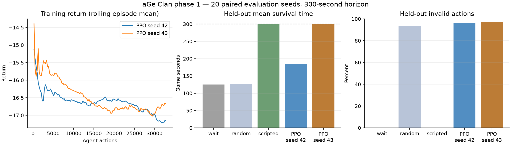

# 1차 PPO 학습 결과 · 2026-10-21

**두 모델을 실제 학습했으며, 시드 43 모델은 서로 다른 평가 집합 두 개에서 각각 20/20회
300게임초를 생존했습니다. 다만 규칙 기반 정책보다 약하고, 실패 행동이 약 97%로 실전 모델은 아닙니다.**

## 실행과 모델

[사전 학습 설계](../../TRAINING_PLAN.md), [설정](../../configs/phase1.json)을 사용했습니다.
SB3 PPO / PyTorch CPU, MlpPolicy, 정책망·가치망 각각 64×64 Tanh, 파라미터 38,702개입니다.
148개 관측을 정규화하고 173개 행동 중 선택합니다. Adam, 학습률 0.0003, rollout 256,
batch 64, epochs 4, gamma 0.99, GAE lambda 0.95, clipping 0.2, entropy 계수 0.01입니다.

학습 seed 42와 43에서 각각 32,768행동, 합계 **65,536행동**을 학습했습니다.
측정 학습 시간은 각각 약 58.6초·61.7초입니다(라이브러리 시작 및 별도 평가 시간 제외).
8,192행동마다 모델/정규화 checkpoint를 저장했고 최종 모델도 별도로 저장했습니다.
게임 규칙·관측·행동·보상은 실험 중 변경하지 않았습니다.

## 첫 번째 공통 평가: Python seed 20000–20019

모든 정책에 같은 시드와 300게임초 제한을 적용했습니다. PPO 평가는 결정적 행동을 선택하고,
관측 정규화 통계를 동결했습니다. 무작위 정책은 173개 행동에서 균등 표집합니다.

| 정책 | 300초 생존 | 평균 생존초 | 평균 completed | 평균 처치 | 평균 보상 | 실패 행동 |
| --- | ---: | ---: | ---: | ---: | ---: | ---: |
| 대기 | 0/20 | 125.0 | 1.00 | 0.00 | -11.00 | 0.00% |
| 무작위 | 2/20 | 125.7 | 1.15 | 5.85 | -15.71 | 93.38% |
| 고정 궁수 건설/강화 | 20/20 | 300.0 | 6.00 | 69.00 | +6.69 | 0.00% |
| PPO seed 42 | 6/20 | 183.8 | 1.90 | 10.90 | -16.10 | 96.17% |
| PPO seed 43 | 20/20 | 300.0 | 4.70 | 52.05 | -9.71 | 97.23% |

`completed`는 엔진의 최고 완료 웨이브 번호입니다. 적이 성에 도달해 피해를 준 경우도 있으므로
이 숫자를 무손실 방어 성공 횟수로 해석하지 않습니다. 300초 생존은 무한 방어 또는 PvP 승리가 아닙니다.

## 초기 가중치 대조

훈련 모델이 처음부터 우연히 좋은 행동을 했는지 확인하기 위해, 같은 초기화 seed로 만든
**학습 전 가중치에 최종 학습 모델과 같은 관측 정규화 통계**를 적용했습니다.
이는 정규화 효과를 통제한 가중치 대조이며, 데이터 수집도 하지 않은 완전한 사전 평가와는 다릅니다.
같은 20000–20019 시드에서 초기 가중치의 두 모델은 모두 0/20회 생존했습니다.
평균 생존초는 seed 42가 126.8초, seed 43이 125.0초였습니다.
학습 후의 생존 개선이 관측 정규화 통계 변화만으로 설명되지는 않습니다.

재현 예:

```bat
"%PYTHON%" -m ml.evaluate --run-dir ml/runs/phase1-20261021/seed-43 --initial-policy --episodes 20 --seed 20000
```

## 선택 모델의 새 평가: Python seed 30000–30019

앞선 평가에서 더 나았던 seed 43을 선택하고 **추가 학습 없이** 새 시드 20개에 평가했습니다.

| 정책 | 300초 생존 | 평균 completed | 평균 처치 | 평균 HP | 평균 보상 | 실패 행동 |
| --- | ---: | ---: | ---: | ---: | ---: | ---: |
| 규칙 기반 | 20/20 | 6.0 | 69.7 | 132.0 | +6.70 | 0.00% |
| PPO seed 43 | 20/20 | 4.9 | 53.7 | 90.4 | -9.32 | 97.08% |

새 시드에서도 생존했지만 완료 진척·처치·남은 HP·보상에서 규칙 기반 정책에 뒤처집니다.
40개의 평가 에피소드 결과는 탐색 실험이며 모든 시드에서의 생존을 보장하지 않습니다.
이 결과를 근거로 seed 43을 **다음 실험의 비교용 모델**로 보존하며 운영 배포하지 않습니다.

```bat
"%PYTHON%" -m ml.benchmark --config ml/configs/phase1.json --run-dir ml/runs/phase1-20261021/seed-43 --episodes 20 --seed 30000 --output ml/runs/phase1-20261021/new-confirmation.json
```

## 무엇을 배웠고 무엇이 막혔나

seed 43, 평가 seed 30000의 300행동 진단에서 궁수 강화 행동을 123회 선택했으나 119회 실패했습니다.
궁수 pad 11 건설은 51회 중 50회 실패했습니다. 실제로 일부 건설·강화는 수행했지만,
이미 설치된 터나 강화 상한·자원 조건에 맞춰 행동을 바꾸지 못하는 반복이 확인됩니다.
상태를 보고 올바른 조건을 판단하는 일반적인 전략을 습득했다고 볼 수 없습니다.



학습 중 확률적 탐색의 평균 보상은 뚜렷하게 좋아지지 않았습니다. 결정적 평가의 생존 개선과
학습 보상을 구분해야 합니다. 특히 더 오래 살아남으면 실패 행동 감점도 더 많이 누적되므로,
현재 보상만으로 생존 능력을 충분히 평가하기 어렵습니다.

다음 실험의 우선순위는 **실제 엔진 검사를 재사용한 합법 행동 마스크**입니다.
먼저 마스크 정확성·부작용 없음·대기 행동 보장을 검사한 뒤, 동일한 두 학습 시드와
새 평가 시드로 비마스킹 PPO와 비교하는 것이 적절합니다. 보상 개편까지 한꺼번에 적용하면
원인을 분리하기 어려우므로 이번 1차 결과를 고정한 상태에서 한 가지씩 바꿉니다.
장시간 무한 학습, PvP 상대, 운영 배포는 아직 진행하지 않았습니다.

## 증거와 로컬 산출물

- `comparison.json`, `confirmation.json`: 정책별 전체 에피소드와 집계 결과.
- `initial-weights-summary.json`: 초기 가중치 대조 요약.
- `diagnostic-seed-43.json`: 한 에피소드의 행동별 선택·실패 횟수.
- `progress-seed-42.csv`, `progress-seed-43.csv`: 학습 진행·보상·손실·KL 기록.
- `provenance.json`: 환경 소스 해시, 버전, 설정, 모델 구조, 모델/정규화 파일 SHA-256.
- 로컬 모델: `ml/runs/phase1-20261021/seed-42/`, `seed-43/`.

모델·정규화·checkpoint는 Git에 포함하지 않습니다. GitHub에는 재현 코드와 측정 보고서를 제공합니다.
최종 검증: Python 환경/학습 테스트 11개, Node 원본 엔진 일치 검사, git diff 검사를 통과했습니다.
운영 PvP/배포와 OpenAI API는 사용하거나 변경하지 않았습니다.
