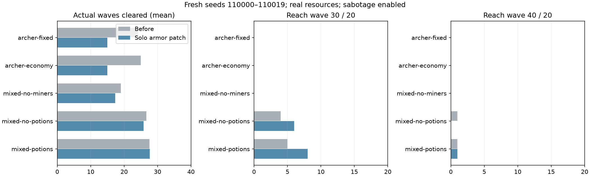

# 문명 전환 밸런스 패치 검증

계획/개발 시작2026-10-22, 새 검증 결과 정리2026-10-24.
사용자 요구는 기존 궁수20허용을 대체해 **궁수 단일 전략은15웨이브를 넘기지 못하고,
발리스타 등 상위 포탑·경제·문명 전환을 활용해야 한다**는 것이다.
현재는 검증한 소스 패치를 PR에 제공하는 단계이며 사이트/Cloudflare 배포나main병합은 하지 않았다.

## 채택한 최소 변경

- 혼자하기에서13웨이브부터 중장갑 적(heavy/brute/saboteur)의 궁수 화살 저항을 적용한다.
- 화살 피해 감소는13/14/15/16/17이후에 각각20/40/60/80/90%다. 최대90%로 제한한다.
- 적이 즉시 죽거나궁수 사용을 금지하는 규칙은 없다. 빠른 경장 적에게는 궁수가 계속 기존 피해를 준다.
- 발리스타/폭격포/서리/번개 포탑, 물약,12웨이브까지의전투, PvP 피해 규칙은 그대로다.
- 천둥70%도별도로 시험했으나40성공이개발3/10→3/10으로늘지않고평균진척이줄어채택하지않았다.
  실제패치의천둥효과는60%를유지한다. 비용/해금/연구/채굴/수리/교란병 수치는 바꾸지 않았다.
- public/game/balance.js의soloArrowResistance, 원본game.js, 생성본lib/game-engine.js를 함께 반영한다.
  플레이 설명에중장갑/상위문명 대응을 추가했고 편집기 저장·기존JSON가져오기에서 새 설정이유실되지않도록했다.

## 실제 자원 제약의 정책 대조

기존엔진/밸런스는ml/balance/fixtures에보존했다. 같은 실제 원본 엔진에서 후보만주입한다.
정책 초도시행착오는[PLAN](PLAN.md)에기록했으며아래비교는 최종고정한같은정책을 모든후보에적용했다.
개발100000–100009에서기존/저항만/저항+천둥70%를비교해 **저항만**을선택한뒤,
새시드110000–110019에서 기존/선택후보를검증했다. 새검증을보고후보를바꾸지않았다.
개발150판+새검증200판, 최종고정정책비교350판의측정시간합계501.55초다(초도정책pilot시간제외).
모두한Node프로세스씩순차실행했고PPO학습/운영방/로그인/전투명령/부하시험은없었다.

- 궁수고정: 궁수Lv5/성5/고정배치·재건설. 추가광부/물약없음.
- 궁수경제: 궁수만쓰되광부증원/성강화/벌목·수리를활용한다.
- 조합광부미증원: 상위포탑/성/벌목/연구/수리/물약정책에서광부증원만끈다.
- 경제조합물약미사용: 경제·상위포탑정책에서물약사용만끈다. 연구·시설투자는그대로유지하는대조다.
- 경제조합물약사용: 같은정책에서30이후위험상황에천둥/얼음사용을허용한다.

마지막두정책은동일연구비용을지출해사용효과를비교한것이며, 물약없는최적자원재배분전략을증명하지않는다.
광부고용비용/실제수입/문명해금/건설과연구시간/크리스탈비용/교란병파괴/수리는모두실제규칙을따른다.

## 새20시드 결과

| 정책 | 기존 평균 완료 | 패치 평균 완료 | 패치20도달 | 패치30도달 | 패치40도달 |
| --- | ---: | ---: | ---: | ---: | ---: |
| 궁수고정 | 24.20 | 15.00 | 0/20 | 0/20 | 0/20 |
| 궁수경제·성강화·수리 | 24.95 | 15.00 | 0/20 | 0/20 | 0/20 |
| 조합·광부미증원 | 19.05 | 17.35 | 2/20 | 0/20 | 0/20 |
| 경제조합·물약미사용 | 26.65 | 25.80 | 16/20 | 6/20 | 0/20 |
| 경제조합·물약사용 | 27.60 | 27.65 | 16/20 | 8/20 | 1/20 |



**궁수두정책은새검증각20판모두15완료후16에서함락됐다.** 개발까지포함한선택후보의두궁수정책60판에서
15를넘지않았다. 이는시험한배치/운영정책/시드의결과이며모든가능한궁수전략의수학적상한은아니다.
30정책은광부증원과조합활용에서성과가있고,40은물약사용정책에서만1판성공했다.
하지만물약의전역적필수성을증명한것은아니며40성공1/20은약한근거다. 추가정책과시드로검증해야한다.
기존밸런스에서는물약미사용정책도40을1/20성공했다.

패치경제조합/물약미사용은평균생존1709.43초/처치613.05/피해327.4/누수17.65/최종HP0,
물약사용은1877.75초/처치693.8/피해326.5/누수17.15/최종HP5.9였다. 모든실험의실행거절은0이다.
실제종료한연속웨이브수로측정하며엔진completed최대번호만으로판정하지않는다.

물약사용20판의실제건설누계는궁수128/발리스타185/폭격포191/서리63,
천둥55회/얼음176회다. 성최종레벨은9–15였으며번개포탑은해금·건설하지못했다.
따라서현대문명·번개포탑까지활용하는최종밸런스를완성했다고볼수없다.
다음에는크리스탈수입/문명해금병목과강한궁수배치의반례를별도격리실험으로확인한다.
고정휴리스틱을실제첫판/2–3판/중수인구의대표표본으로해석하지않는다.

## 소스·회귀 검증과 운영 상태

- 450개 실제투사체사례: 시드가아닌wave/kind/type/solo·PvP조합의피해검사.
  초반/경장/상위포탑/PvP무영향, 단계저항,원본브라우저/생성본/실험후보일치검사통과.
- 실제자원으로끝까지진행한궁수/혼합물약두경로의후보VM–패치생성본결과가완전히같았다.
- 편집기새설정저장/사용자JSON가져오기/기존JSON기본상속/잘못된값거절검사통과.
- check-pvp/check-overhaul, 원본브라우저·match-engine상태일치,마스크5,709개대조,보상·목표검사통과.
- Python환경테스트9개(Gymnasium/SB3 check_env포함)와구문/diff검사통과.
- snapshot으로기존엔진을재현하며실험마다소스해시/정책/전체에피소드·집계/단계별결과를기록했다.
  exporter는같은정책해시/분모/실행거절0/궁수상한/40시나리오를검증했다. 그림도육안확인했다.
- 2026-10-24 10:29한국시간공개8개GET표본은모두200/API ready였다.
  사이트game.js/balance.js의해시는패치전fixture와일치하고현재후보와는달랐다. **아직사이트미반영**이다.
  이는실제방/전체사용자지연/오류율검증이아니다.
- main병합/Cloudflare·Sites배포/DB변경/OpenAI API/유료자원은수행하지않았다.

## 재현

저장소루트에서실행하며JSON출력은새이름을사용한다. 비교실행은하나씩순차수행한다.

```bat
node tools/sync-engine.mjs
node ml/balance/test_civilization.mjs
node ml/balance/test_editor.mjs
node tools/check-pvp.mjs
node tools/check-overhaul.mjs
node ml/balance/civilization.mjs baseline 20 110000 ml/runs/ops/new-before.json
node ml/balance/civilization.mjs armor-020 20 110000 ml/runs/ops/new-after.json
```

기존PPO모델·로그는보존한다. 실제게임규칙해시가바뀌었으므로옛모델을새규칙으로그냥재개하거나
과거평가점수와직접비교하면안된다. 기존호환성검사를완화하거나옛manifest를덮어쓰지않았다.
