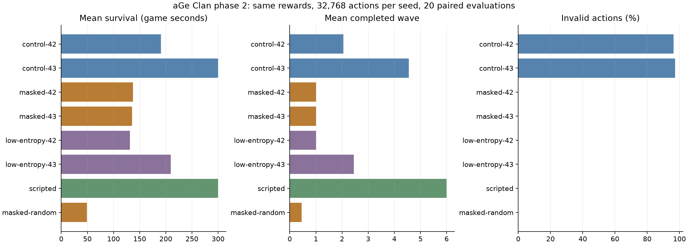

# 2차 결과: 행동 마스크와 탐색 계수 · 2026-10-22

**합법 행동 마스크는 실패 행동을 0%로 줄였습니다. 하지만 마스크만 적용한 모델은 방어를 배우지
못했습니다. 탐색 계수를 낮춘 후보는 일부 개선됐지만 기존 비마스킹 모델을 대체할 성능은 아닙니다.**

[실험 설계](../../MASKING_PLAN.md)에 따라 보상·148개 관측·173개 행동·망 구조는 유지했습니다.
SB3/Contrib 2.9.0, CPU에서 각 조건의 seed 42·43을 각각 32,768행동 학습했습니다.
비마스킹 대조군 2개, MaskablePPO 2개, MaskablePPO의 entropy 계수만 0.01에서 0.003으로 낮춘
후속 후보 2개로, 총 6개 모델·196,608행동입니다. 기존 원본 모델·로그는 덮어쓰지 않았습니다.

## 개발 평가: 같은 Python seed 40000–40019

| 조건 | seed | 300초 생존 | 평균 생존초 | 평균 completed | 평균 처치 | 평균 보상 | 실패 행동 |
| --- | ---: | ---: | ---: | ---: | ---: | ---: | ---: |
| PPO 기준 | 42 | 6/20 | 190.5 | 2.05 | 12.85 | -16.20 | 96.39% |
| PPO 기준 | 43 | 20/20 | 300.0 | 4.55 | 50.85 | -9.93 | 97.28% |
| MaskablePPO | 42 | 0/20 | 137.0 | 1.00 | 0 | -11.88 | 0% |
| MaskablePPO | 43 | 0/20 | 135.3 | 1.00 | 0 | -11.65 | 0% |
| 마스크 + entropy 0.003 | 42 | 0/20 | 131.6 | 1.00 | 2.00 | -10.98 | 0% |
| 마스크 + entropy 0.003 | 43 | 3/20 | 209.2 | 2.45 | 17.25 | -7.83 | 0% |
| 고정 궁수 건설/강화 | — | 20/20 | 300.0 | 6.00 | 69.00 | +6.69 | 0% |
| 합법 행동만 균등 무작위 | — | 0/20 | 49.1 | 0.45 | 0.05 | -12.28 | 0% |

평가에서도 현재 마스크를 predict에 전달했습니다. 마스킹 모델은 두 계수에서 모두 실패 행동이
0이었지만, 생존과 처치가 크게 줄었습니다. 유효한 행동만 선택하는 것과 좋은 전략을 학습하는 것은
별개입니다. 보상만 보면 낮은 탐색 후보가 PPO 기준보다 높지만, 비마스킹의 실패 행동 감점이
누적되기 때문에 이 점수만으로 후보를 채택하지 않았습니다.

## 새 검증: Python seed 50000–50019

각 조건에서 seed 43을 비교했고 추가 학습은 하지 않았습니다.

| 모델 | 300초 생존 | 평균 생존초 | 평균 completed | 평균 처치 | 평균 HP | 실패 행동 |
| --- | ---: | ---: | ---: | ---: | ---: | ---: |
| PPO 기준 | 20/20 | 300.0 | 4.75 | 52.65 | 84.0 | 97.23% |
| MaskablePPO | 0/20 | 135.6 | 1.00 | 0 | 0 | 0% |
| 마스크 + entropy 0.003 | 8/20 | 235.6 | 3.20 | 25.20 | 6.4 | 0% |
| 고정 궁수 건설/강화 | 20/20 | 300.0 | 6.00 | 69.10 | 132.0 | 0% |

낮은 탐색 계수는 마스킹 조건 안에서 개선을 보였지만 seed 42는 여전히 실패했습니다.
두 학습 시드만의 탐색 실험이므로 학습 안정성을 확보했다고 볼 수 없습니다. 기존 비마스킹
최선 모델과 낮은 탐색 마스킹 후보를 별도로 보존하며 운영에 배포하지 않습니다.

## 행동 진단과 다음 가설

마스킹 seed 42의 개발 평가 총 행동 중 대기 2,560회, 벌목 고용 100회, 수리 80회였고
포탑 건설과 처치가 없었습니다. entropy 0.003의 seed 43은 궁수 pad 3 건설을 에피소드당
한 번씩 선택하고 일부 강화도 했지만, 대기가 4,016회로 대부분이었습니다.
각 에피소드의 action_counts는 원시 JSON에 기록했습니다.

실패 행동 제거 자체는 검증됐습니다. 이제 충분한 방어 전략을 학습할 경험과 보상 신호가 부족한지
살펴야 합니다. 다음 단계는 다른 설정을 고정하고 기존 마스킹 후보를 추가 32,768행동씩 재개해
학습량만 비교합니다. 모델/optimizer/정규화 통계를 이어받는 --resume-from을 구현·검증했습니다.
새 에피소드에서 시작하며 게임 도중 상태나 RNG를 정확히 복원하는 기능은 아닙니다.
그다음에도 성능이 늘지 않으면 보상 또는 초기 난이도를 한 번에 하나씩 바꿉니다.

## 검증·보존·계속 실행

- 환경 테스트 8개, 학습 테스트 4개 통과. 마스킹 학습/평가·재개·설정 변경 거절 포함.
- 엔진과 마스크의 5,709개 판정 일치, 상태/ID/시간/RNG 불변성, 원본 게임 상태 일치 검사 통과.
- 복제 상태에서 실제 엔진 메서드를 호출하며, 종류별 건설 판정 최적화도 전체 행동 oracle로 검사.
- 모델/정규화/checkpoint는 ml/runs/phase2-*-20261021/seed-*에 보존하며 Git에는 포함하지 않음.
- 원시 평가 JSON, 진행 CSV, 소스/산출물 해시와 버전은 이 보고서 폴더에 포함.
- 벽시계 로그가 날짜를 넘겨 길게 기록된 구간이 있어 순수 계산 속도 비교에는 사용하지 않음.
- 2시간 간격 자동화에서 다음 한 요소 실험을 이어가며, 실행당 최대 2시드·65,536행동으로 제한.
- 운영 PvP·DB·사이트·배포와 OpenAI API는 사용하거나 변경하지 않음.

기존 모델의 소스 해시 검사를 우회하지 않고 현재 브리지에서 비마스킹 대조군을 재학습했습니다.
1차 모델을 재평가하려면 그 당시 커밋의 코드를 사용하세요. 과거 파일을 새 해시로 덮어쓰지 않습니다.
