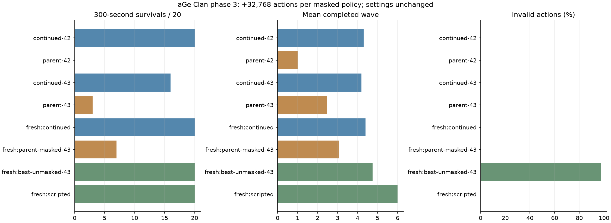

# 3차 결과: 마스킹 모델의 추가 학습

**설정을 바꾸지 않고 학습량만 늘려, 마스킹 모델이 새 평가 시드에서 20/20회 300게임초를
생존하고 실패 행동 0%를 유지했습니다. 이전 최선 마스킹 모델은 같은 시드에서 7/20회였습니다.**

[실행 전 계획](PLAN.md)에 따라 기존 entropy 0.003 모델의 두 seed를 각각 추가 32,768행동
학습했습니다. 이번 추가량은 합계 65,536행동, 모델당 누적량은 65,536행동입니다.
모델/optimizer/관측 정규화 통계를 이어받았으며 보상·망 구조·마스크·환경·학습률 등은 유지했습니다.
게임 중간 상태나 난수를 그대로 복구한 것은 아니며 새 에피소드에서 재개했습니다.

## 같은 개발 시드 40000–40019에서 부모와 비교

| 모델 | 누적 행동 수 | 300초 생존 | 평균 completed | 평균 처치 | 평균 HP | 평균 보상 | 실패 행동 |
| --- | ---: | ---: | ---: | ---: | ---: | ---: | ---: |
| 부모 seed 42 | 32,768 | 0/20 | 1.00 | 2.00 | 0.0 | -10.98 | 0% |
| 재개 seed 42 | 65,536 | 20/20 | 4.30 | 36.70 | 72.8 | +2.56 | 0% |
| 부모 seed 43 | 32,768 | 3/20 | 2.45 | 17.25 | 2.2 | -7.83 | 0% |
| 재개 seed 43 | 65,536 | 16/20 | 4.20 | 38.30 | 63.4 | +0.53 | 0% |

사전 기준인 생존 → completed → 처치 → HP → 보상 순으로 seed 42를 선택했습니다.
후보 선택에 다음 새 검증 집합은 사용하지 않았습니다.

## 새 검증 시드 60000–60019

| 정책 | 300초 생존 | 평균 completed | 평균 처치 | 평균 HP | 평균 보상 | 실패 행동 |
| --- | ---: | ---: | ---: | ---: | ---: | ---: |
| 새 마스킹 seed 42 | 20/20 | 4.40 | 41.45 | 85.6 | +3.19 | 0% |
| 이전 최선 마스킹 seed 43 | 7/20 | 3.05 | 23.55 | 5.4 | -5.11 | 0% |
| 비마스킹 기준 seed 43 | 20/20 | 4.75 | 52.20 | 82.4 | -9.66 | 97.20% |
| 고정 궁수 건설/강화 | 20/20 | 6.00 | 69.40 | 132.0 | +6.69 | 0% |
| 무작위 | 1/20 | 1.05 | 4.35 | 3.0 | -16.37 | 93.33% |
| 대기 | 0/20 | 1.00 | 0 | 0 | -11.00 | 0% |



새 마스킹 모델을 마스킹 조건의 비교 기준으로 채택합니다. 기존 비마스킹 모델도 보존합니다.
300초 생존과 실패 행동에서 유의미한 개선이 있지만, 처치/웨이브 진척은 비마스킹 기준과 규칙 기반보다
낮습니다. 비마스킹 기준은 32,768행동 모델이므로 같은 학습 예산에서 알고리즘 우월성을 보인 것은
아닙니다. 현재 실험은 추가 경험이 부족했던 마스킹 정책을 개선하는지 확인한 학습량 비교입니다.
20개 시드·두 학습 seed의 탐색 결과이며 무한 방어, 장기 안정성 또는 PvP 성능을 보장하지 않습니다.

## 보존과 재현

- 새 모델: `ml/runs/phase3-continued-20261022/seed-42`, `seed-43`.
- 이전 모델/로그는 수정하거나 삭제하지 않았습니다. 모델은 Git에 올리지 않습니다.
- `results.json`: 모든 개발/새 검증 에피소드와 행동 횟수.
- `provenance.json`: 실제 추가/누적 step, 설정, 런타임, 소스와 모델/정규화 SHA-256.
- `progress-seed-*.csv`: 재개 학습 보상·손실·KL 로그.
- 재개 경로 검사는 `ml.test_training.TrainingTests.test_masked_training_and_evaluation`을 통과했습니다.
- `phase3.py` 실행에서 두 모델의 추가 32,768/누적 65,536 행동 수를 확인했습니다.

```bat
"%PYTHON%" -m ml.phase3 --output ml/runs/new-phase3
```

## 다음 실험

현재 두 재개 모델에서 설정을 고정한 채 각각 32,768행동씩 더 학습해, 모델당 누적 98,304행동을
비교합니다. 개발 집합은 유지하고 최종 검증은 새 seed 70000–70019를 사용합니다.
실패 행동 0과 생존 20/20을 유지하면서 completed·처치·HP가 향상되는지 확인합니다.
정체될 경우 학습량을 계속 늘리는 대신 한 요소의 별도 가설로 전환합니다.
이번에는 보상/초기 난이도 변경이나 운영 PvP/DB/사이트/배포/OpenAI API 사용을 하지 않았습니다.
