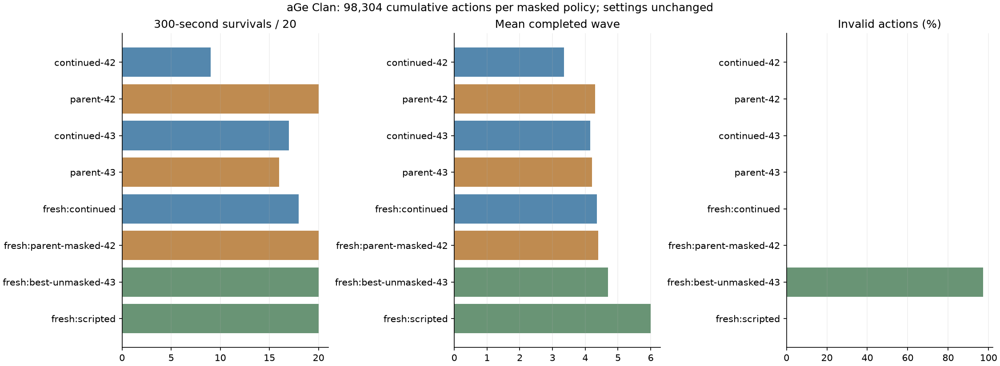

# 4차 결과: 학습량 증가의 퇴행 확인, 기존 최선 유지

**같은 설정에서 두 모델을 더 학습했지만 기존 마스킹 최선을 개선하지 못했습니다.
기존 모델을 교체하지 않았으며, 추가 학습량 증가만 반복하는 방식에서 다음 한 요소 가설로 전환합니다.**

[사전 계획](PLAN.md)에 따라 3차 모델의 seed 42·43에서 모델/optimizer/정규화 통계를 이어받아
각각 32,768행동을 추가했습니다. 이번 추가량은 총 65,536행동, 모델당 누적은 98,304행동입니다.
보상·망 구조·300초 제한·마스크·entropy 0.003·학습률 0.0003 등 다른 설정은 유지했습니다.

## 같은 개발 시드 40000–40019

| 모델 | 누적 행동 | 300초 생존 | 평균 completed | 평균 처치 | 평균 HP | 평균 보상 | 실패 행동 |
| --- | ---: | ---: | ---: | ---: | ---: | ---: | ---: |
| 부모 seed 42 | 65,536 | 20/20 | 4.30 | 36.70 | 72.8 | +2.56 | 0% |
| 재개 seed 42 | 98,304 | 9/20 | 3.35 | 30.45 | 18.4 | -3.54 | 0% |
| 부모 seed 43 | 65,536 | 16/20 | 4.20 | 38.30 | 63.4 | +0.53 | 0% |
| 재개 seed 43 | 98,304 | 17/20 | 4.15 | 37.85 | 61.2 | +0.90 | 0% |

seed 42는 생존·진척·처치·HP 모두 퇴행했습니다. seed 43은 생존이 한 회 늘었지만 진척·처치·HP는
조금 줄었습니다. 사전 후보 선택 순서에 따라 이번 후보는 seed 43이며, 기존 부모들 중 최선은 seed 42입니다.

## 새 검증 시드 70000–70019

| 정책 | 300초 생존 | 평균 completed | 평균 처치 | 평균 HP | 평균 보상 | 실패 행동 |
| --- | ---: | ---: | ---: | ---: | ---: | ---: |
| 이번 후보 seed 43 | 18/20 | 4.35 | 39.25 | 68.0 | +1.76 | 0% |
| 기존 마스킹 최선 seed 42 | 20/20 | 4.40 | 40.30 | 84.2 | +3.03 | 0% |
| 비마스킹 기준 seed 43 | 20/20 | 4.70 | 51.00 | 80.4 | -9.78 | 97.22% |
| 고정 궁수 건설/강화 | 20/20 | 6.00 | 69.05 | 132.0 | +6.69 | 0% |
| 무작위 | 2/20 | 1.35 | 7.70 | 4.6 | -16.10 | 93.48% |
| 대기 | 0/20 | 1.00 | 0 | 0 | -11.00 | 0% |



새 검증에서도 후보는 기존 마스킹 최선을 넘지 못했습니다. **최선 마스킹 모델은 계속
ml/runs/phase3-continued-20261022/seed-42**입니다. 이번 두 후보는 비교 자료로만 보존합니다.
20개 시드의 탐색 실험이며 이 결과만으로 퇴행의 원인이나 모든 환경에서의 성능을 확정하지 않습니다.
연속 미개선 실험은 1회입니다. 운영 배포나 모델 교체는 하지 않았습니다.

## 다음 한 요소 가설

추가 업데이트가 기존 방어 정책을 불안정하게 만들었을 가능성을 검토합니다. 원인을 학습률로
확정한 것은 아니며, 다음에는 **학습률만 0.0003 → 0.0001**로 낮춰 비교합니다.
부모는 퇴행한 이번 후보가 아니라, 같은 출발점인 3차의 seed 42·43 모델을 사용합니다.
각각 추가 32,768행동, 누적 98,304행동으로 맞춰 이번 4차 조건과 예산을 같게 합니다.
마스크·보상·정규화 갱신·entropy·PPO 나머지 설정은 유지합니다.
개발 집합은 40000–40019를 유지하고 새 최종 검증은 80000–80019를 사용합니다.

현재 resume는 PPO 설정 변경을 거절하므로, 다음 실행 전에 학습률만 명시적으로 허용하는 경로를
구현·검증해야 합니다. 다른 설정 변경은 계속 거절하고 부모/자식 설정 차이를 기록합니다.
저장된 설정값뿐 아니라 실제 optimizer learning rate와 schedule이 새 값인지 검사해야 합니다.
이 변경과 다음 학습은 이번 65,536행동 제한 이후의 다음 자동 실행에서 진행합니다.

## 증거와 검증

- `results.json`: 모든 개발/새 검증 에피소드·행동 횟수. `summary.json`: 집계.
- `provenance.json`: 실제 추가/누적 step, 설정, 버전, 모델/정규화 및 환경 소스 해시.
- `progress-seed-*.csv`: 학습 보상·손실·KL 기록.
- 모델은 ml/runs/phase4-continued-20261022에만 저장하며 기존 모델은 수정/삭제하지 않았습니다.
- 실행 전 재개 학습 테스트 통과. 실제 두 실행에서 32,768 추가량/98,304 누적량을 확인했습니다.
- 재사용 가능한 `ml/export_continued.py`를 추가했고, 고정 3차 결과로 export 일치 검사 및 실제 4차
  step/선택/검증값 검사를 통과했습니다. 그림은 육안 확인했습니다.
- 운영 게임/PvP/DB/사이트/배포/OpenAI API/유료 자원은 사용하거나 수정하지 않았습니다.

```bat
"%PYTHON%" -m ml.phase3 --parents ml/runs/phase3-continued-20261022 --confirmation-seed 70000 --output ml/runs/new-phase4
"%PYTHON%" -m ml.export_continued --run-dir ml/runs/new-phase4 --output ml/reports/new-phase4
```
