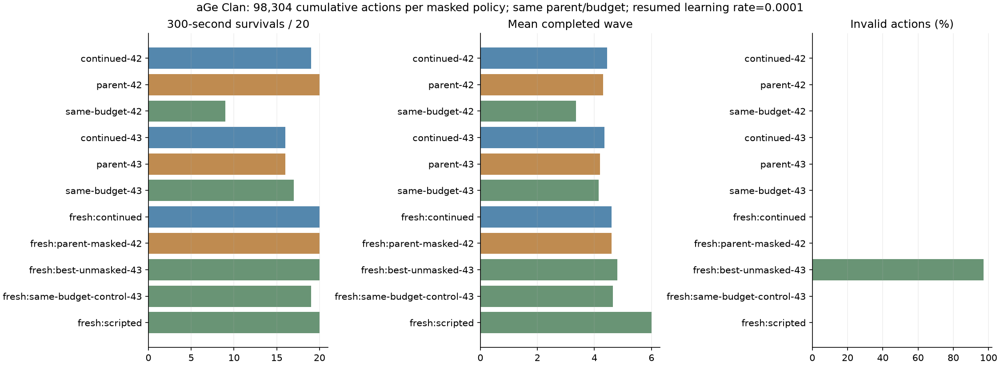

# 5차 결과: 낮은 학습률의 퇴행 완화, 기존 최선 유지

**학습률을 0.0003에서 0.0001로 낮추자 seed 42의 추가 학습 퇴행은 줄었지만,
기존 최선 모델을 개선하지 못해 교체하지 않았습니다.**

[사전 계획](PLAN.md)대로 3차의 seed 42·43 모델에서 각각 32,768행동을 추가했습니다.
이번 학습량은 합계 65,536행동, 모델당 누적 98,304행동입니다. CPU 1스레드이며
실제 학습 시간 합계는 약 367초(6.1분)이며 [provenance.json](provenance.json)의 wall_seconds에 기록했습니다.
4차와 부모·예산을 맞추고 학습률만 변경했습니다. 모델은 MaskablePPO, 정책망과 가치망은
각각 64×64 Tanh, 총 38,702개 파라미터, Adam입니다. 보상·마스크·entropy 0.003은 유지했습니다.

## 개발 평가: seed 40000–40019

| 모델 | 300초 생존 | 평균 생존초 | completed | 처치 | HP | 보상 | 실패 행동 |
| --- | ---: | ---: | ---: | ---: | ---: | ---: | ---: |
| 부모 seed 42, 누적 65,536 | 20/20 | 300.00 | 4.30 | 36.70 | 72.8 | +2.563 | 0% |
| 같은 예산 LR 0.0003 seed 42 | 9/20 | 252.84 | 3.35 | 30.45 | 18.4 | -3.537 | 0% |
| 이번 LR 0.0001 seed 42 | 19/20 | 298.56 | 4.45 | 40.20 | 73.8 | +2.552 | 0% |
| 부모 seed 43, 누적 65,536 | 16/20 | 293.43 | 4.20 | 38.30 | 63.4 | +0.531 | 0% |
| 같은 예산 LR 0.0003 seed 43 | 17/20 | 295.23 | 4.15 | 37.85 | 61.2 | +0.896 | 0% |
| 이번 LR 0.0001 seed 43 | 16/20 | 294.40 | 4.35 | 38.25 | 63.4 | +0.576 | 0% |

seed 42에서는 같은 예산 대조군보다 생존이 9→19회로 개선됐습니다. seed 43에서는
17→16회여서 낮은 학습률이 항상 낫다고 결론 내릴 수 없습니다.
생존→completed→처치→HP→보상의 사전 순서로 이번 후보는 seed 42,
같은 예산 대조군의 후보는 seed 43입니다. 서로 다른 seed를 선택한 후보 간 비교는
단일 seed에서의 학습률 효과와 구분해야 합니다.

## 새 검증: seed 80000–80019

| 정책 | 300초 생존 | 평균 생존초 | completed | 처치 | HP | 보상 | 실패 행동 |
| --- | ---: | ---: | ---: | ---: | ---: | ---: | ---: |
| 이번 후보 seed 42 | 20/20 | 300.00 | 4.60 | 44.95 | 87.6 | +3.753 | 0% |
| 기존 마스킹 최선 seed 42 | 20/20 | 300.00 | 4.60 | 45.75 | 97.0 | +3.809 | 0% |
| 같은 예산 LR 0.0003 후보 seed 43 | 19/20 | 298.38 | 4.65 | 45.30 | 84.0 | +3.243 | 0% |
| 비마스킹 기준 seed 43 | 20/20 | 300.00 | 4.80 | 53.75 | 92.4 | -9.375 | 97.07% |
| 규칙 기반 | 20/20 | 300.00 | 6.00 | 69.50 | 132.0 | +6.695 | 0% |
| 무작위 | 1/20 | 117.65 | 1.00 | 5.10 | 1.6 | -16.114 | 93.07% |
| 대기 | 0/20 | 125.00 | 1.00 | 0 | 0 | -11.000 | 0% |



이번 후보는 새 검증에서 생존 20/20회와 실패 행동 0%를 유지했지만, 기존 최선과 completed가
같고 처치·HP·보상이 낮습니다. 따라서 **최선은 계속
ml/runs/phase3-continued-20261022/seed-42**입니다. 모든 모델은 보존합니다.
규칙 기반보다 진척·처치가 낮으며, 20개 평가 시드와 두 학습 seed만으로 일반 성능이나
퇴행 원인을 확정하지 않습니다. 연속 미개선 실험은 2회입니다.

## 구현과 검증

- train()의 --resume-learning-rate는 재개 시 학습률 하나만 명시적으로 변경합니다.
  저장 모델을 불러올 때 schedule을 교체하고 optimizer의 이전 LR도 갱신하며 Adam 통계는 유지합니다.
  config만 바꾼 암묵적 변경과 다른 PPO 설정 변경은 거절합니다.
- Python 환경 테스트 8개와 학습 테스트 5개 통과. 새 테스트는 저장/재로딩한 실제 schedule과
  optimizer LR, optimizer step 지속, 호출자 config 불변, 잘못된 override 거절을 확인합니다.
- Node 브리지 원본/서버 공유 규칙 일치 및 마스크 판정 5,709개 대조 통과.
- 실제 두 모델도 저장 후 재로딩해 LR/schedule/optimizer 0.0001, 부모/대조군 설정 일치,
  각 32,768 추가량·98,304 누적량을 확인했습니다.
- results.json은 모든 에피소드와 행동 횟수, summary.json은 집계,
  provenance.json은 버전/설정/변경점/소스 및 산출물 해시, CSV는 학습 로그입니다.
  그림도 육안 확인했습니다. 모델은 ml/runs/phase5-low-lr-20261022에만 보존합니다.

## 다음 한 요소 가설

학습률만 낮추어도 기존 최선을 넘지 못했습니다. 다음에는 **관측 정규화 통계 갱신만 동결**하여
재개 중 입력 분포 변환의 변화가 퇴행에 영향을 주는지 확인합니다. 원인을 확정한 것은 아닙니다.
같은 3차 부모·LR 0.0001·추가 32,768행동씩으로 맞추고 이번 5차를 같은 예산 대조군으로 사용합니다.
보상 정규화는 계속 꺼 두며 정책 학습은 수행하고 관측 통계만 고정합니다.
개발 40000–40019, 새 검증 90000–90019에서 비교합니다. 먼저 실제 통계 불변/학습 지속 테스트와
명시적 override 기록을 구현해야 합니다. 이번 실행에서는 추가 학습하지 않습니다.
다음에도 개선하지 못하면 연속 3회가 되므로 이유와 선택지를 한 번 제시하고 새 지시를 기다립니다.

```bat
set "PYTHON=C:\Users\pc\aGe-ai\.venv\Scripts\python.exe"
"%PYTHON%" -m ml.phase3 --parents ml/runs/phase3-continued-20261022 --resume-learning-rate 0.0001 --same-budget-control ml/runs/phase4-continued-20261022 --confirmation-seed 80000 --output ml/runs/new-phase5
"%PYTHON%" -m ml.export_continued --run-dir ml/runs/new-phase5 --output ml/reports/new-phase5
```

운영 PvP·DB·사이트·배포는 변경하지 않았고 OpenAI API·유료 자원도 사용하지 않았습니다.
