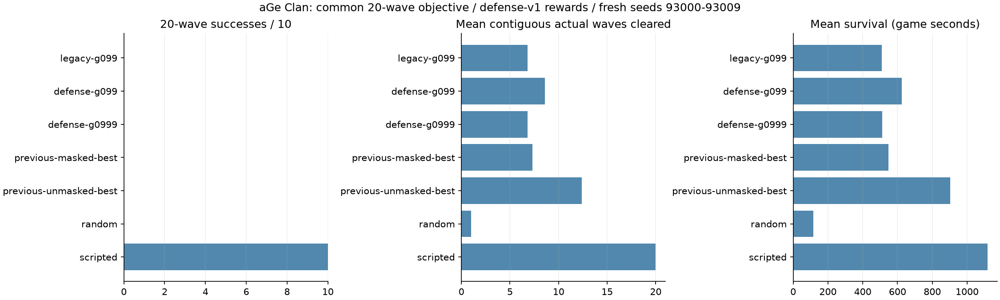

# 6차: 20웨이브 목표, 방어 품질 보상 및 할인율 비교

**새 보상은 같은 학습 예산 대조군보다 새 검증의 실제 완료 웨이브를6.8→8.6으로 늘렸습니다.
할인율0.999는 개선되지 않아0.99를 유지합니다. 학습 모델의20웨이브 성공은 아직0/10입니다.**

[사전 계획](PLAN.md), [파라미터 근거·확대 예상·실패 행동 정의](PARAMETERS.md).
사용자 요청에 따라 이전 관측 통계 동결 계획 대신 보상과20웨이브 목표를 우선했습니다.

## 패치한 보상과 목표

- 실제 종료된 웨이브 각각에 대해 **처치한 적수 / 그 웨이브 전체적수**를 지급합니다.
  모두 처치하면+1, 전원 누수면0입니다. 부분 누수는 그만큼 품질 보상을 줄입니다.
  기존 completed 최댓값 차이를 사용하지 않아 높은 번호가 먼저 끝나는 중복/선지급 문제를 피합니다.
- 성에 통과한 적도 엔진의 처리 완료에는 포함되지만, 새 보상에서는 처치로 세지 않습니다.
  성 함락 때문에 활성 웨이브가 정리된 경우에는 완료/품질 보상을 지급하지 않습니다.
- 나머지는 처치+.01, 성HP피해-.02/HP, 실행 거절-.05, 함락-10, 목표달성+10을 유지합니다.
  건설·고용·회복 자체의 직접 보상은 없습니다. 생존 시간 자체도 점수를 주지 않습니다.
- 목표는 **1–20번 웨이브가 모두 실제 종료되고 성HP>0, 활성 웨이브/잔여 적이 없는 상태**입니다.
  무피해 클리어만을 성공으로 요구하지는 않으며, 누수는 품질/피해로 구분합니다.
- 300초 종료를 제거했습니다. 3,000게임초 안전 제한은 truncated이고 성공 보상은 없습니다.
  목표를 넘는 수동 웨이브 시작은 학습 전용 제약으로 거절하며 마스크에도 적용합니다.
- 실제 완료수/연속 완료수/누수/누적 피해/보상 항목별 합계를 기록합니다.
  누적 피해는 수리·강화가 있으면 시작HP100을 넘을 수 있습니다.

## 같은 부모와 예산의 세 단계

모두 phase3-continued-20261022/seed-42에서 가중치/Adam/관측 정규화를 이어받았습니다.
각각 추가16,384행동/누적81,920행동, 합계49,152행동, 학습 seed42 하나입니다.
CPU1스레드, 실제 학습 시간 합계247.38초(4.1분)입니다. 각각 같은 부모에서 출발하며 순서대로 이어 학습하지 않았습니다.
목표20·안전 제한·LR .0001·n_steps256·batch64·epoch4·entropy .003·망을 공통 고정했습니다.

1. A: 기존 보상, gamma .99. 새 목표로 같은 양을 더 학습한 대조군.
2. B: defense-v1 보상, gamma .99. A와 보상만 다릅니다.
3. C: defense-v1 보상, gamma .999. B와 할인율만 다릅니다.

모든 평가 정책에 같은 **defense-v1 보상과20웨이브 목표**를 적용했습니다.
학습 중 서로 다른 보상식의 raw return은 직접 비교하지 않습니다.
목표/보상 변경은 strict resume가 아닌 명시적 transfer로 기록했으며,
실제 엔진 해시/관측·행동 스키마를 검사했습니다. 옛 모델/manifest는 수정하지 않았습니다.

## 개발 seed 92000–92009

| 실험 | 20목표 성공 | 실제 연속 완료 | 생존초 | 처치 | HP | 누수 | 누적피해 | 공통 보상 | 실패율 |
| --- | ---: | ---: | ---: | ---: | ---: | ---: | ---: | ---: | ---: |
| A 기존 보상/.99 | 0/10 | 7.0 | 522.89 | 82.8 | 0 | 17.6 | 172.2 | -6.679 | 0% |
| B 새 보상/.99 | 0/10 | 8.9 | 645.03 | 113.7 | 0 | 20.3 | 200.4 | -5.082 | 0% |
| C 새 보상/.999 | 0/10 | 7.1 | 536.28 | 80.3 | 0 | 21.1 | 208.0 | -7.554 | 0% |

사전 기준으로 B를 선택했습니다. 성공은 모두0이므로 실제 진척으로 비교했습니다.

## 새 검증 seed 93000–93009

| 정책 | 20목표 성공 | 실제 연속 완료 | 생존초 | 처치 | HP | 누수 | 누적피해 | 공통 보상 | 실패율 |
| --- | ---: | ---: | ---: | ---: | ---: | ---: | ---: | ---: | ---: |
| A 기존 보상/.99 | 0/10 | 6.8 | 509.65 | 78.3 | 0 | 18.0 | 169.4 | -6.941 | 0% |
| B 새 보상/.99 | 0/10 | 8.6 | 623.46 | 108.2 | 0 | 20.5 | 197.0 | -5.463 | 0% |
| C 새 보상/.999 | 0/10 | 6.8 | 511.51 | 78.7 | 0 | 18.5 | 184.0 | -7.170 | 0% |
| 이전 마스킹 최선 | 0/10 | 7.3 | 549.07 | 81.8 | 0 | 22.2 | 215.2 | -7.569 | 0% |
| 이전 비마스킹 기준 | 0/10 | 12.4 | 902.65 | 205.5 | 0 | 4.3 | 100.0 | -42.335 | 99.04% |
| 무작위 | 0/10 | 1.0 | 115.41 | 4.2 | 0 | 13.2 | 101.6 | -17.093 | 93.52% |
| 규칙 기반 | 10/10 | 20.0 | 1117.43 | 390.8 | 126.0 | 0.2 | 6.0 | +33.781 | 0% |

B는 A보다 평균 완료가1.8웨이브(+26.5%), 생존시간이113.81초 늘었습니다.
짝지은10개 새 평가 시드에서 완료수 차이는[2,2,2,2,1,2,2,2,2,1]로 모두 양수입니다.
다만 B의 누수/누적피해는 A보다 늘었으며 더 오래 버틴 영향을 분리하지 않은 절대 합계입니다.
방어 품질의 모든 측면이 개선됐다고 주장하지 않습니다. 최종HP는 학습 정책 모두0입니다.

C는 B보다 나빠서 gamma .999를 채택하지 않았습니다. 장기 할인율을 올리면 항상 좋아진다는
가설은 이번 예산에서 지지되지 않았습니다. gae_lambda .95/가치망/수집 길이256을 그대로 둔
상황이므로 .999 자체가 항상 나쁘다는 결론도 아닙니다.

20목표의 잠정 마스킹 참조는 **ml/runs/phase6-wave20-20261022/defense-g099**입니다.
예전300초 기준은 계속 phase3 seed42로 보존합니다. B가 이전 비마스킹 기준의12.4웨이브를
넘지 못했다는 점도 중요합니다. 비마스킹은 실패 패널티 때문에 보상은 낮지만 실제 진척은 더 높습니다.
따라서 점수나 실패율만으로 전체 전략 우열을 판단하지 않습니다.
규칙 기반의10/10 성공은20목표와 성공 판정이 실제 엔진에서 달성 가능함을 확인합니다.

한 학습 seed·각16,384 추가행동·새 평가10개의 작은 실험이며 최종 채택/일반화 확정은 아닙니다.
훈련/평가 목표가 바뀌었으므로 과거300초 결과와 보상/생존을 그대로 비교하지 않습니다.
현재 학습 모델은 모두300초를 넘겼지만 결국 함락됐습니다. results의survivals_300은10이며
horizon_survivals는 안전 시간 제한 생존을 뜻하므로0입니다.

## 테스트와 증거

- Python 환경9개·학습6개 통과: 기존14개 일괄 및 새20목표 check_env 테스트1개.
- 새 Node 보상 테스트: 전원 누수/부분 처치/고번호 선완료/연속 목표/목표 초과 마스크/함락/수리/시간 제한.
- 기존 브라우저·서버 엔진 일치 및 마스크5,709개 판정 대조 통과.
- exporter에서 실제 세 모델을 재로딩해 gamma와rollout gamma(.99/.999), LR/schedule/optimizer(.0001),
  부모·학습량·동일 설정/소스 검사를 통과했습니다. 총49,152 추가행동과 학습10분 미만을 확인했습니다.
- 모든 에피소드의 항목별 보상 합계가 보고된 보상과 일치하고, 목표 성공은 실제20연속완료/HP양수인지 검사했습니다.
- results.json: 전체 개발/새 검증 및 실제 manifests. summary.json: 집계. provenance.json: 버전/환경/모델 해시.
  progress-*.csv: 세 실험 학습 로그. comparison.png: 육안 확인 완료.
- 모델/정규화/checkpoint는 ml/runs에만 저장합니다. 운영 게임/PvP/DB/배포/OpenAI API는 변경/사용하지 않았습니다.

## 다음 소규모 실험

먼저 다른 학습 seed43의 같은3차 부모에서 A(기존보상/.99)와 B(새보상/.99)를 반복해
보상 개선이 학습 seed에도 유지되는지 확인합니다. 그 다음 C는 .999보다 작은 .995로
장기 할인율을 단계적으로 비교할 수 있습니다. 같은 부모·16,384행동씩 세 변형이면 총49,152행동입니다.
새 개발94000–94009/새 검증95000–95009로 기존 모델/규칙/무작위도 같이 비교합니다.
다음 실행 전 사전 계획과 명시적 runner 인자를 추가해야 합니다. 망/epoch/보상 가중치는 동시에 바꾸지 않습니다.
새20목표 실험의 연속 미개선 횟수는0입니다. 이전300초 연구의 미개선2회는 별도 이력으로 보존합니다.
